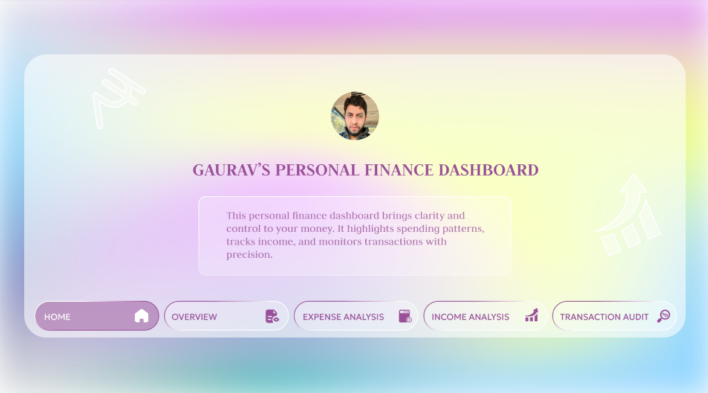
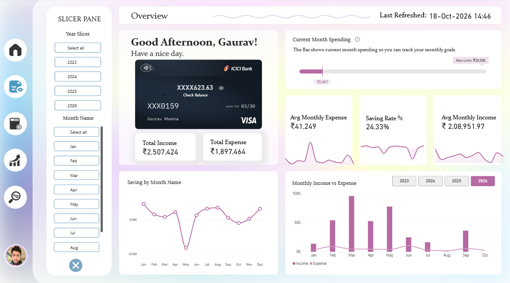

# 💰 Personal Finance Dashboard (PostgreSQL & Power BI Project)

> An end-to-end personal finance analytics project built with **PostgreSQL, Power BI, DAX, SVG, Figma, and an Antigravity-built companion app**. It brings income, expenses, savings, transaction activity, and audit history together in an interactive financial dashboard.

## 🧩 Project Overview

This project explores how a personal finance system can be monitored through an interactive analytics dashboard. PostgreSQL stores financial transactions and maintains audit and archive records, while Power BI connects to the database through **DirectQuery** to visualize financial performance and transaction history.

The dataset covers **2023 through the current month of 2026 and continues to grow**. The interface is designed in **Figma**, with consistent styling, custom navigation, slicers, dynamic text cards, and SVG-based visuals. A companion app built with **Antigravity** lets users check dataset statistics and add, update, or remove transaction records.

📊 **Project goals**
- Track income, expenses, balance, and monthly savings.
- Understand spending patterns by month, category, and transaction type.
- Compare income and expenses over time.
- Monitor transaction changes, deletions, restorations, and archived records.
- Manage transaction data through a companion app.
- Demonstrate how PostgreSQL audit logic can be explored through Power BI.

## ⚙️ Tech Stack

| Tool | Purpose |
|------|---------|
| 🗃️ **PostgreSQL** | Financial data storage, relational tables, constraints, triggers, functions, audit logging, archive and restore logic |
| 📊 **Power BI** | Interactive dashboards, KPI cards, charts, tables, slicers, and report navigation |
| 🧮 **DAX** | Measures, dynamic titles, KPI comparisons, conditional messages, and SVG visuals |
| 🎨 **Figma** | Dashboard UI/UX, navigation elements, and custom visual design |
| 🔌 **DirectQuery** | Connects Power BI visuals to PostgreSQL data |
| 🛠️ **Antigravity** | Companion app for checking dataset statistics and adding, updating, or removing records |
| 🐙 **GitHub** | Version control and project documentation |

## 🗄️ Database Overview

The PostgreSQL database is organized around these tables:

| Table | Purpose |
|-------|---------|
| `source` | Defines source types used to classify financial records, such as Income and Expense |
| `category` | Stores transaction categories and their source relationship |
| `finance` | Main financial transaction table, including date, amount, type, note, source, and category |
| `audit_log` | Records transaction actions and tracked old/new values |
| `archive` | Stores deleted transaction records for audit and recovery workflows |

The SQL script also defines calendar views for transaction dates and audit timestamps.

### Database features

- Primary and foreign key relationships.
- Check constraints for valid amounts and transaction types.
- Trigger-based audit logging for updates and deletions.
- Archiving of deleted finance records.
- A restore function for returning archived transactions to the finance table.
- Threshold logic that raises a notice when monthly expenses reach the configured limit.
- Calendar views that expose year, month, month name, and month-year fields for reporting.

> **Data note:** The database contains personal financial data, so the underlying dataset is not shared publicly. The public Power BI report provides an interactive way to explore the visualizations without sharing the raw personal records. Some audit-history entries were created as simulated sample history for demonstration; those timestamps should not be interpreted as verified real-world event times.

## 📈 Dashboard Pages

The report contains five pages with shared navigation, slicers, a refresh timestamp, and a clear-all-slicers control. KPI cards and other visuals are listed separately below.

### 🏠 Page 1: Home

**Purpose:** Provide a landing page and navigate between report sections.

**Visuals**
- Figma-designed home screen.
- Custom navigation to the dashboard pages.



### 📊 Page 2: Overview

**Purpose:** Provide a quick view of the overall financial position.

**KPIs**
- Total Income.
- Total Expense.
- Average Monthly Expense.
- Saving Rate.
- Average Monthly Income.

**Visuals**
- Current-month spending tracker with a ₹20,000 reference limit, created with an SVG-based DAX measure.
- Debit-card-style balance visual showing income minus expenses.
- Monthly trend lines for average expense, saving rate, and average income.
- Saving by Month line chart.
- Monthly Income vs Expense chart, with a slicer configured for that visual only.
- Refresh date and time.



### 💸 Page 3: Expense Analysis

**Purpose:** Investigate expense patterns and identify major spending categories.

**KPIs**
- Highest Expense Transaction, with a monthly trend.
- Average Expense Transaction, with a monthly trend.
- Total Expense.
- Number of Expense Transactions.

**Visuals**
- Top 5 Expense Categories stacked bar chart.
- Dynamic text card highlighting the previous month's top expense category and its percentage.
- Donut chart showing expenses split between Cash and Accounts.
- Donut chart showing the number of expense transactions split between Cash and Accounts.
- Monthly Expense vs all-time Average Expense comparison.
- Category-by-month table.
- Expense by Category stacked bar chart.


### 📈 Page 4: Income Analysis

**Purpose:** Understand income sources and savings performance over time.

**KPIs**
- Total Income, with current-versus-previous-year change in value and percentage.
- Net Saving, with a monthly trend.
- Saving Rate.
- Average Monthly Income.

**Visuals**
- Dynamic message showing the highest-saving month of the year, with wording that changes for the current or a past month.
- Saving vs Bonus vs Salary by Month chart.
- Year-over-year income comparison and tooltip growth percentage.
- Net Savings Over Time line chart.
- Income by Category bar chart.
- Monthly Income vs the average income for the same month.


### 🧾 Page 5: Transaction & Audit Analysis

**Purpose:** Monitor transaction activity and explore audit and archive records.

**KPIs**
- Total Transactions.
- Cash Transactions.
- Accounts Transactions.
- Correction activity summaries for amount, category, transaction date, and transaction type.

**Visuals**
- Dynamic text card comparing deletion and restoration activity.
- SVG progress bar for DELETE, RESTORE, and UPDATE audit activity.
- Transaction Volume Over Time line chart, with a visual-specific year slicer.
- Cash vs Accounts transaction visuals.
- Archived Transactions table.
- Audit Activity by Action across year and month.
- Dynamic message identifying the most frequent type of correction.


## 🛠️ Personal Finance Management Application

A CRUD app built using **Google's Antigravity**,integrated with PostgreSQL as the primary database. The application provides a user-facing interface for managing financial transactions.

**Key Features:**

- Create: Add new income and expense transactions.
- Read: View transaction records and inspect dataset statistics.
- Update: Edit existing transaction details.
- Delete: Remove transactions while supporting database-level archiving and audit logging.
- Data Validation: Maintain transaction integrity through database constraints and validation rules.
- PostgreSQL Integration: Store and manage financial records in the same database used by the Power BI dashboard.

This complements the Power BI report: the app provides a way to manage and inspect the dataset, while Power BI focuses on financial trends and audit analysis. Database triggers and functions support the audit and archive workflows where applicable.

## 🔄 Refresh and Interactivity

- Power BI uses PostgreSQL **DirectQuery** for report data.
- The report is configured for a **59-second page refresh**.
- A refresh date/time indicator is displayed on the pages.
- A clear-all-slicers control is available throughout the report.
- Some slicers are intentionally configured to affect only specific visuals.
- DAX measures power dynamic messages, KPI comparisons, and custom SVG-based visuals.

Actual data freshness depends on the Power BI report settings, the DirectQuery connection, and the environment in which the report is running.

## 🧾 Selected PostgreSQL SQL Examples

The project SQL script includes table definitions, calendar views, constraints, triggers, functions, and analytical queries. The following examples highlight a few of the database concepts used.

### 1. Monthly calendar fields for transaction reporting

```sql
CREATE OR REPLACE VIEW finace_calender AS
SELECT transaction_id,
       transaction_date,
       EXTRACT(MONTH FROM transaction_date)::INT AS month,
       EXTRACT(YEAR FROM transaction_date)::INT AS year,
       TO_CHAR(transaction_date, 'Mon') AS month_name,
       TO_CHAR(transaction_date, 'YYYY-MM') AS month_year,
       transaction_date::DATE AS trans_date
FROM finance;
```

### 2. Audit a deleted transaction and archive its previous values

The delete trigger copies the old transaction values to the archive table and records a `DELETE` event in `audit_log` before the row is removed from `finance`.

```sql
INSERT INTO archive (
    transaction_id, transaction_date, amount,
    transaction_type, note, source_id, category_id
)
VALUES (
    OLD.transaction_id, OLD.transaction_date, OLD.amount,
    OLD.transaction_type, OLD.note, OLD.source_id, OLD.category_id
);

INSERT INTO audit_log (
    action, transaction_id, old_amount, old_category,
    old_source_id, old_transaction_type, old_transaction_date
)
VALUES (
    'DELETE', OLD.transaction_id, OLD.amount, OLD.category_id,
    OLD.source_id, OLD.transaction_type, OLD.transaction_date
);
```

*These statements illustrate the core logic inside the trigger function; they are not intended to be run separately outside that function.*

### 3. Track changes with old and new values

The update trigger records the previous values and only fills a new-value field when the corresponding value has changed.

```sql
INSERT INTO audit_log (
    action, transaction_id,
    old_amount, new_amount,
    old_category, new_category,
    old_source_id, new_source_id,
    old_transaction_type, new_transaction_type,
    old_transaction_date, new_transaction_date
)
VALUES (
    'UPDATE', OLD.transaction_id,
    OLD.amount, CASE WHEN OLD.amount = NEW.amount THEN NULL ELSE NEW.amount END,
    OLD.category_id, CASE WHEN OLD.category_id = NEW.category_id THEN NULL ELSE NEW.category_id END,
    OLD.source_id, CASE WHEN OLD.source_id = NEW.source_id THEN NULL ELSE NEW.source_id END,
    OLD.transaction_type, CASE WHEN OLD.transaction_type = NEW.transaction_type THEN NULL ELSE NEW.transaction_type END,
    OLD.transaction_date, CASE WHEN OLD.transaction_date = NEW.transaction_date THEN NULL ELSE NEW.transaction_date END
);
```

### 4. Compare income in the current and previous year

```sql
WITH current_year_income AS (
    SELECT SUM(amount) AS total_income
    FROM finance
    WHERE source_id = 2
      AND EXTRACT(YEAR FROM transaction_date) = EXTRACT(YEAR FROM CURRENT_DATE)
),
previous_year_income AS (
    SELECT SUM(amount) AS total_income
    FROM finance
    WHERE source_id = 2
      AND EXTRACT(YEAR FROM transaction_date) = EXTRACT(YEAR FROM CURRENT_DATE) - 1
)
SELECT c.total_income AS current_year_income,
       p.total_income AS previous_year_income
FROM current_year_income AS c
CROSS JOIN previous_year_income AS p;
```

## 🧠 Key Skills Demonstrated

- PostgreSQL table design and relational constraints
- SQL views, joins, aggregations, and date logic
- SQL triggers and PL/pgSQL functions
- Audit logging and old/new value tracking
- Archive and restore workflows
- Power BI DirectQuery
- DAX measures, dynamic text, and SVG visuals
- KPI cards, donut charts, bar charts, line charts, matrices, and tooltips
- Slicer interactions and report navigation
- Figma-based dashboard UI/UX design
- Companion app workflow for dataset management
- Financial and transaction audit analysis

## 🚀 How to Explore the Project

The underlying dataset contains personal financial information and is **not publicly shared**. Instead, you can explore the published Power BI report through the public link below.

### [Open the Interactive Personal Finance Dashboard](https://bit.ly/personal_finance_dashboard)

> *Explore the dashboard, interact with slicers, compare income and expenses, follow savings trends, and investigate transaction and audit visuals—all through the live Power BI report.*

The report is intended for interactive viewing. The public link does not provide access to the private source dataset or database credentials.

## 👨‍💻 About Me

Hi, I'm **Gaurav Khanna**, a Data Analyst interested in turning data into clear, useful insights through SQL, data modeling, and interactive dashboards.

## 🤝 Connect with Me

🌐 **Portfolio:** [gouravkhanna03.github.io/portfolio](https://gouravkhanna03.github.io/portfolio/)  
💼 **LinkedIn:** [Gaurav Khanna](https://www.linkedin.com/in/gauravkhanna03/)  
📧 **Email:** [gouravkhanna03@gmail.com](mailto:gouravkhanna03@gmail.com)

## 🔖 Keywords

`Personal Finance Dashboard` `Power BI` `PostgreSQL` `DirectQuery` `DAX` `Figma` `Antigravity` `Financial Analysis` `Expense Analysis` `Income Analysis` `Savings Analysis` `SQL Triggers` `Audit Logging` `Archive and Restore` `Data Analytics`
